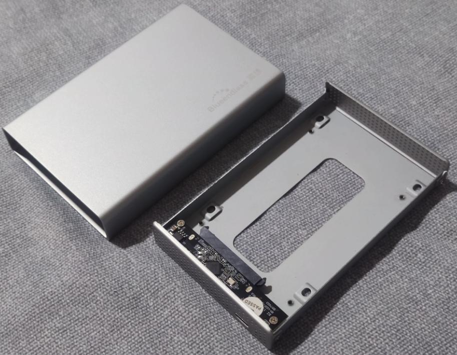
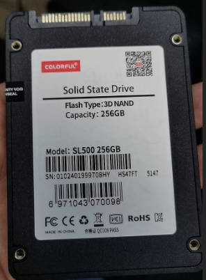
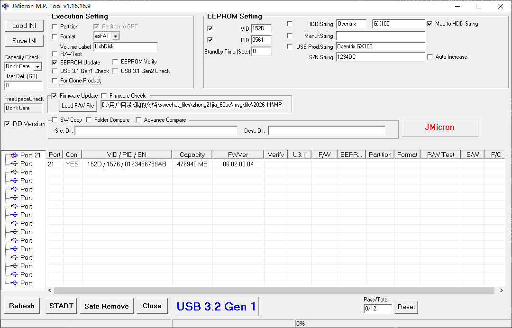
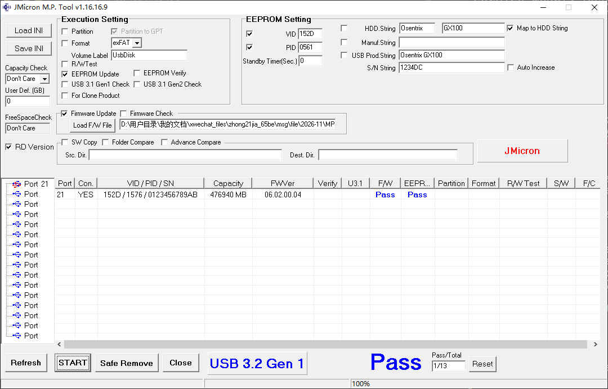
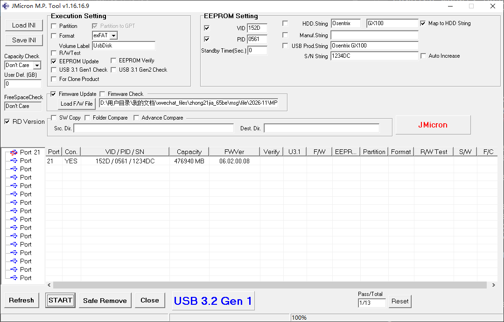
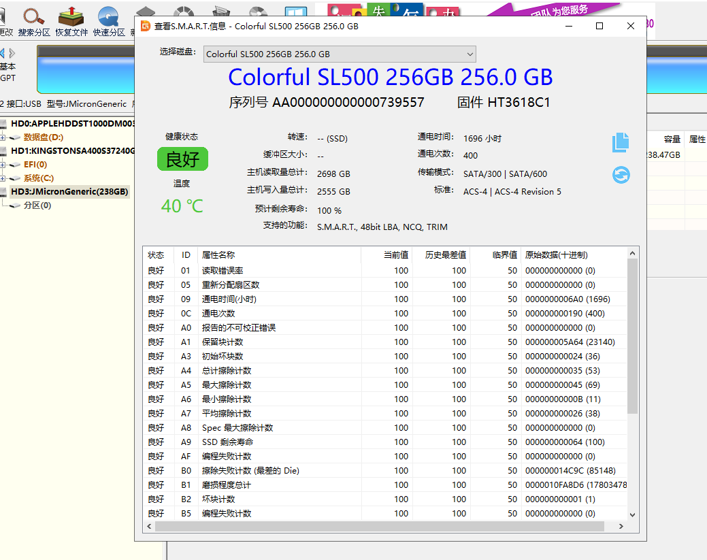
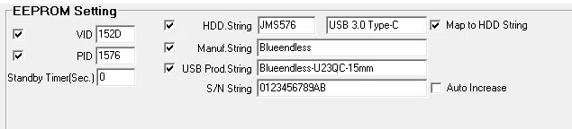

# jMicron-JMS576-Firmware

针对JMS578芯片的固件集合和刷机工具，解决无法识别七彩虹SSD的问题，大概率是UASP的兼容性。支持TRIM、UASP。

## 背景

手上有一个蓝硕2.5寸全金属硬盘盒，USB3.0 Type-C接口，型号U23QC，15mm厚规格。



插入七彩虹 Colorful SL500 256GB SSD有无法识别问题。



这是前提，然后找客服问到技术联系方式，拿到了新版本主控固件。

## 目录说明

```text
Firmware 固件目录
tool     刷机工具
```

## 使用办法

1. 把硬盘盒子接入电脑后置USB口，应该不需要接入硬盘就可以刷机。

2. 打开`JMMassProd.exe`刷机软件。

3. 取消勾选`EEPROM Update`、`For Clone Product`，勾选 `RD Version`，输入密码`jmicron`。



4. 点击`START`进行刷入，等待刷入显示`Pass`。



5. 点击`Safe Remove` 安全断电，重新拔插硬盘盒子数据线，点击`Refresh`刷新显示，最新信息如下。



6. 插入硬盘，打开`DiskGenius`， 查看硬盘SMART信息，说明已经正常可使用了。




## 盒子信息自定义

在`EEPROM Setting`区域，填入你想要的信息。



然后取消勾选`Firmware Update`, 勾选`EEPROM Update`, 再点击`START` 刷入diy信息。
